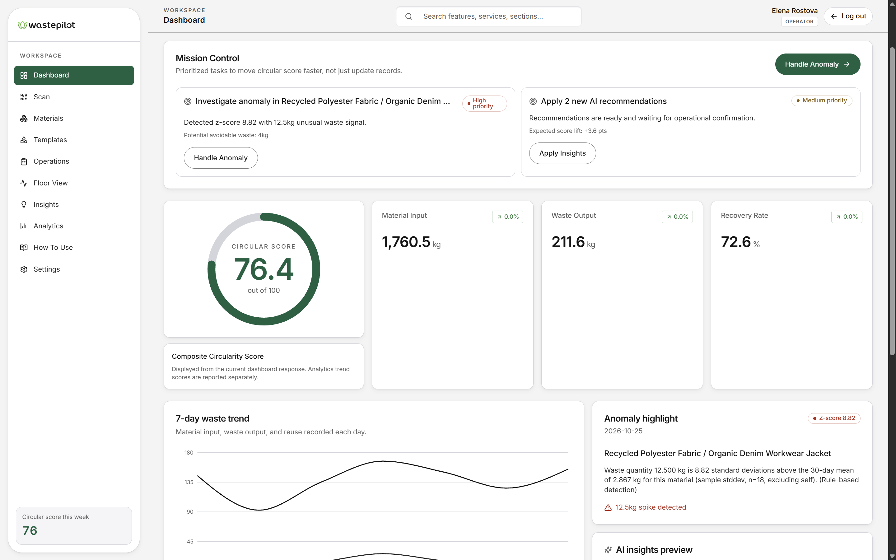
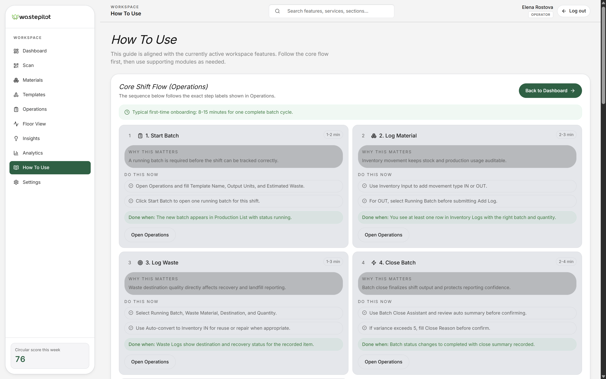
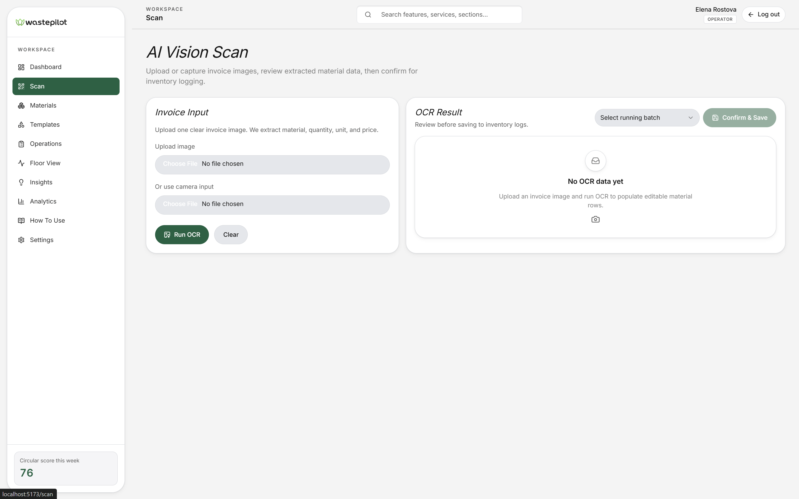
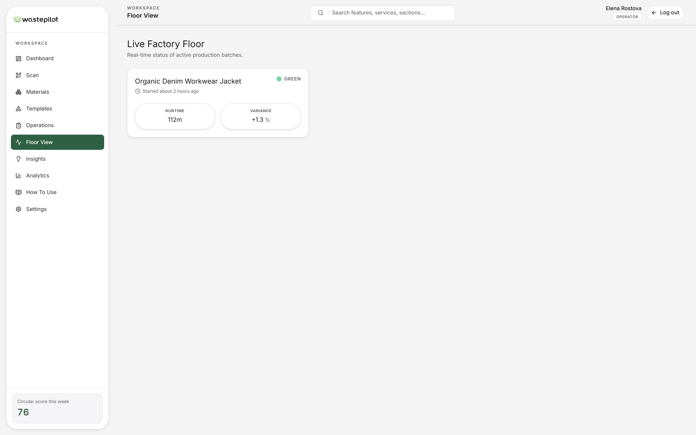
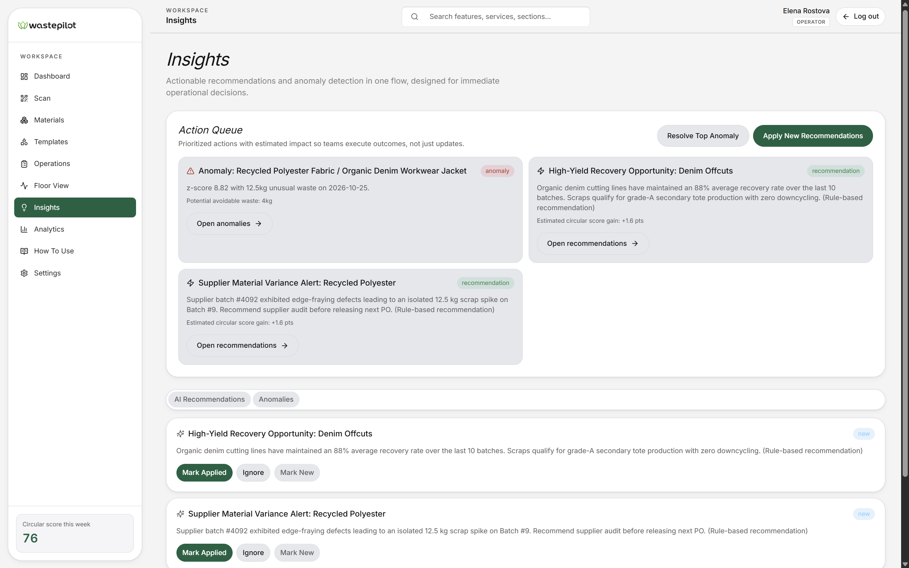
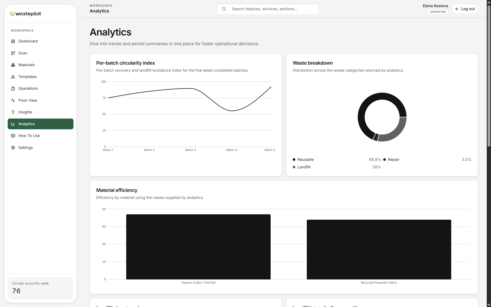
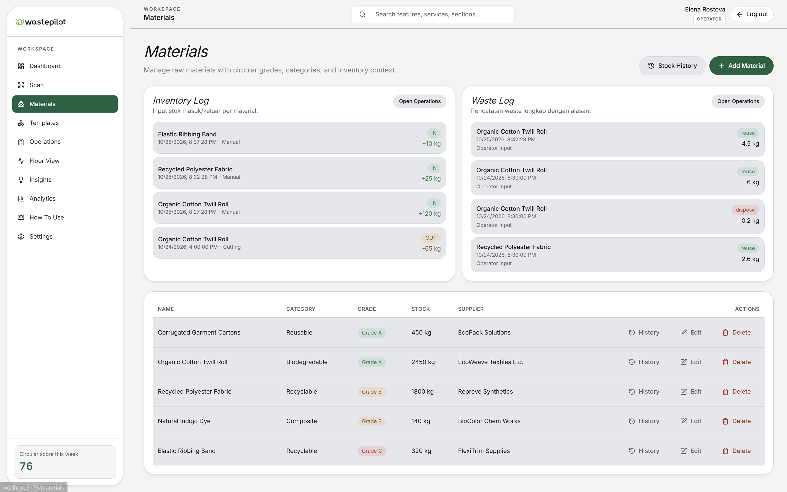
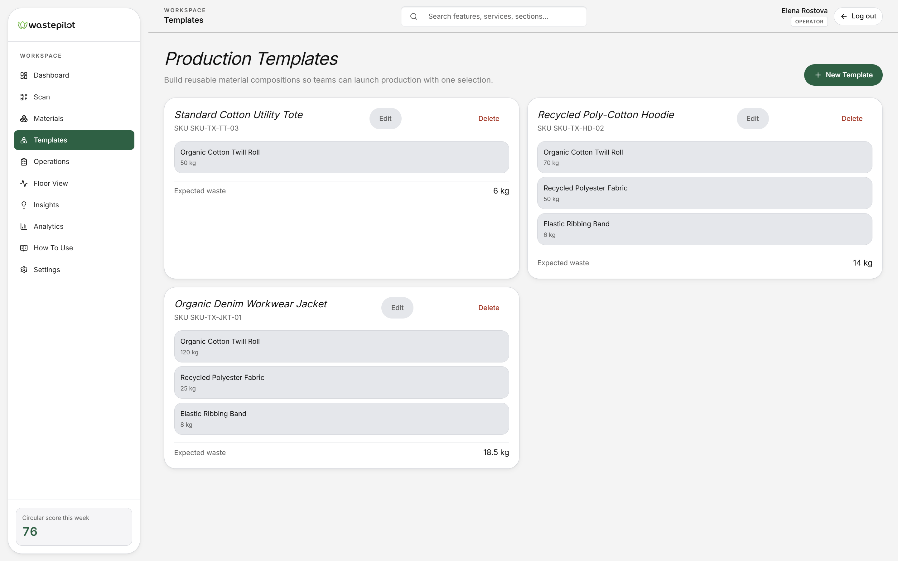

<div align="center">

# WastePilot

### Smart Circular Economy Platform for Manufacturing
#### Turning waste and material records into operational insights

[](https://waste-pilot.vercel.app/)
[](https://github.com/Harvlin/WastePilot)
[](https://github.com/Harvlin/WastePilot/actions)
[](LICENSE)

</div>

---

## Contents

- [Product overview](#product-overview)
- [Implemented capabilities](#implemented-capabilities)
- [Roles and access](#roles-and-access)
- [Metrics and integrity rules](#metrics-and-integrity-rules)
- [AI and data handling](#ai-and-data-handling)
- [Demo and screenshots](#demo-and-screenshots)
- [Architecture and data model](#architecture-and-data-model)
- [Technology stack](#technology-stack)
- [Local setup](#local-setup)
- [User workflows](#user-workflows)
- [API overview](#api-overview)
- [Testing and CI](#testing-and-ci)
- [Security and known limitations](#security-and-known-limitations)
- [Product direction](#product-direction)
- [Team and license](#team-and-license)

---

## Product overview

WastePilot is a web application for recording material use and production waste in manufacturing workflows. It brings batch creation, material and waste logging, recovery tracking, supervisor review, and circularity analytics into one guided application.

The primary shift workflow is:

**Start Batch → Log Material → Log Waste → Close Batch → Integrity Check**

The application is designed for small and mid-size manufacturers, with textile and garment production as an initial target context. It is an operational record-keeping and review tool; its indicators depend on the completeness and accuracy of the data entered. Repository code does not establish that WastePilot has been validated in a production factory, nor does it guarantee reductions in waste or environmental impact.

A public-facing landing page (`/`) serves as the marketing entry point and is separate from the authenticated internal application. The internal app routes begin at `/app` and require a valid JWT.

For requirement-level behavior and additional implementation detail, see the [Product Requirements Document](docs/PRD.md).

### Product goals

- Make shift-level material and waste records easier to capture consistently.
- Give supervisors a review workflow for batch close, anomalies, and data discrepancies.
- Expose the formulas and rules behind circularity metrics and automated signals.
- Reduce manual invoice entry with optional AI-assisted OCR that requires human review.
- Provide a foundation for future integrations without claiming that physical sensor deployments or multi-tenant operations are already supported.

## Implemented capabilities

| Area | Current behavior |
| --- | --- |
| Operations | Guided batch workflow for starting batches, recording inventory and waste, recovering eligible waste, and reviewing batch-close summaries. |
| Materials and templates | CRUD screens and API endpoints for materials, production templates, and template material lines. |
| Batch close | Variance, confidence, and red-flag summary. Final close is restricted to Supervisors; a reason is required when the absolute variance exceeds 5%. |
| Floor View | Shows running batches and health colors. The view refreshes by periodic polling (about every 30 seconds), not by a real-time streaming connection. |
| Invoice scan | Sends an invoice image to Gemini for structured extraction. Users can review and edit extracted lines before saving them. |
| Dashboard | Circular Score, material input, waste output, recovery rate, a seven-day trend, up to three recent insights, and the latest anomaly. |
| Analytics | Five datasets: per-batch circularity index, waste breakdown, efficiency by material, landfill share trend, and landfill intensity trend. The circularity trend uses up to five recent completed batches. |
| Insights and anomalies | Deterministic rules and statistical checks generate review signals. They are not proof of misconduct and are not presented as model-generated AI output. |
| Integrity | Activity logs, audit trail, integrity overview, anomaly review, pattern review, manual/OCR-versus-sensor cross-validation, and audit hash-chain verification. Some review actions are Supervisor-only. |
| Reports | Weekly or monthly summaries with CSV and PDF export. Exported content has the limitations described under [Reports and exports](#reports-and-exports). |
| Sensor prototype | An authenticated ingestion endpoint and a Python simulator for testing request shape. Supports a shared global key and optional per-device keys. This does not certify or validate physical sensor hardware. |
| Settings | Company, timezone, notification preferences, and token-budget settings. Notification delivery and end-to-end token-budget enforcement are not implemented. |

## Roles and access

The application uses two authenticated roles: `OPERATOR` and `SUPERVISOR`. Newly registered users default to `OPERATOR`; the self-service settings API does not allow users to change their own role. Roles are stored in and read from `auth_users.role`; the `user_settings` table does not contain role information.

| Capability | Operator | Supervisor |
| --- | :---: | :---: |
| Dashboard, Analytics, Reports and exports | Yes | Yes |
| Create batches; log inventory and waste; recover eligible waste | Yes | Yes |
| View the batch-close summary | Yes | Yes |
| Finalize a batch close | No | Yes |
| Correct output units after close | No | Yes |
| View the Floor View | Yes | Yes |
| Use invoice OCR | Yes | Yes |
| View activity logs, audit trail, integrity overview, insights and anomalies | Yes | Yes |
| Change insight or anomaly status | No | Yes |
| View Pattern Review and Cross-Validation | No | Yes |
| Verify the audit hash chain | No | Yes |
| Read or update personal settings | Yes | Yes |

These restrictions are enforced by backend authorization, not only by hiding UI controls. The sensor endpoint uses a separate API key credential rather than either user role or a JWT.

## Metrics and integrity rules

Circularity metrics are internal, policy-weighted indicators. They are not an industry-standard formula. Dashboard/Reports and Analytics intentionally use different formulas; changing or unifying them would be a separate business decision.

### Dashboard and Reports: Composite Circularity Score

```text
Recovery Rate      = (reuse kg + repair kg) / total waste kg
Waste Efficiency   = clamp(1 - total waste kg / material input kg, 0, 1)
Landfill Share     = dispose kg / total waste kg
Landfill Avoidance = 1 - Landfill Share

Base Score = 100 × (
    0.30 × Recovery Rate
  + 0.25 × Waste Efficiency
  + 0.45 × Landfill Avoidance
)
```

The score is capped according to landfill share: above 40% → maximum 55; above 30% → maximum 70; above 20% → maximum 80; at or below 20% → no additional cap. The result is bounded to 0–100.

### Analytics: Per-batch Circularity Index

```text
Recovery Rate      = (reuse kg + repair kg) / total waste kg
Landfill Avoidance = 1 - Landfill Share

Base Index = 100 × (
    0.40 × Recovery Rate
  + 0.60 × Landfill Avoidance
)
```

The same landfill-share caps apply. The chart uses up to the five most recently completed batches, ordered chronologically within that sample.

### Other documented calculations

**Batch variance**

```text
Planned input = sum of template line quantities
                (without a template: max(output units × 0.08, 12))
Actual input  = sum of inventory IN logs
Variance %    = (actual input - planned input) × 100 / planned input
```

When a batch has no inventory `IN` logs, the close summary may label its input as estimated. A close reason is required when the absolute variance exceeds 5%. Running batches older than 24 hours are considered overdue.

**Confidence score**

```text
Completeness    = (has inventory OUT + has waste logs + output units > 0) / 3
Timeliness      = 1.0, or 0.72 when batch close is overdue
Audit Integrity = share of audit entries with a meaningful reason (at least 10 characters)
                  (1.0 when there are no applicable entries)

Confidence = 100 × (
    0.50 × Completeness
  + 0.30 × Timeliness
  + 0.20 × Audit Integrity
)
Levels: high ≥ 85, medium ≥ 65, low < 65
```

**Anomaly detection**

- Uses a trailing 30-day baseline per material when at least two records and a non-zero standard deviation are available.
- Uses population standard deviation and flags an upper-tail z-score greater than 2.5.
- With too few records or zero variance, uses a configurable provisional cold-start threshold, defaulting to 10 kg. The fallback is provisional, not an empirically validated material limit.

**Pattern Review** considers up to 20 recently completed batches per user, requires at least five samples, and flags when at least 60% of the sample has an absolute variance from 4.5% through 5.0%.

**Cross-Validation** compares manual/OCR input with sensor input for the same batch and material, only when both sources are present. It flags a relative difference greater than 15%:

```text
Difference % = 100 × |manual kg - sensor kg| / max(manual kg, sensor kg)
```

**Floor View health** is based on absolute variance: green below 3%, amber from 3% up to but not including 5%, and red at 5% or above.

All anomaly, pattern, cross-validation, and red-flag results are review signals. They do not independently establish fraud, policy violations, or the physical correctness of a measurement.

## AI and data handling

WastePilot distinguishes model output from deterministic application logic:

| Capability | Mechanism |
| --- | --- |
| Invoice scan | Gemini vision model extracts structured invoice lines. The result is a suggestion and must be reviewed by the user before saving. |
| Anomaly detection | Statistical calculation with a documented provisional fallback threshold. |
| Pattern Review and Cross-Validation | Deterministic calculations over stored records. |
| Insights and suggested waste actions | Application rules and mappings; not generative-AI recommendations. |

Invoice images are sent to Google Gemini for OCR. Review the provider's current data-handling and retention terms before uploading sensitive documents. A valid Gemini API key is needed for live extraction; a placeholder/mock key does not provide live OCR.

## Demo and screenshots

### Frontend preview

[Open the WastePilot frontend preview](https://waste-pilot.vercel.app/).

The repository contains this frontend link, but does not establish current availability, a public backend URL, successful frontend-to-backend connectivity, or the deployment's secret configuration. Verify the live environment independently before relying on it.

### Repository screenshots

The following images are checked-in snapshots, not evidence of live data. They may not represent the current UI, and displayed values can be sample or historical content. The Floor View image shows an empty state.

<div align="center">
  
  <p><em>Dashboard snapshot with circularity and operational summaries.</em></p>

  
  <p><em>How-to-use guide snapshot. The 8–15 minute onboarding estimate visible in the image has not been validated through measurement.</em></p>

  
  <p><em>Invoice scan flow; extracted lines are reviewed before they are saved.</em></p>

  
  <p><em>Floor View empty state when there are no running batches.</em></p>

  
  <p><em>Insights and integrity review snapshot.</em></p>

  
  <p><em>Analytics snapshot. The circularity trend is limited to the five most recently completed batches.</em></p>

  
  <p><em>Materials and waste logging snapshot.</em></p>

  
  <p><em>Production templates snapshot.</em></p>
</div>

**Video demo:** `[Video URL to be added]` — no published video URL is currently recorded in this repository.

## Architecture and data model

```text
Public landing page (/)
       │ navigation
       ▼
React + TypeScript frontend (/app/*)
       │ REST API / JWT
       ▼
Spring Boot API ─────── MySQL 8.4 (runtime) / 9.7 (CI)
       ├─────────────── Google Gemini (invoice OCR)
       └─────────────── Actuator / Prometheus endpoints

Python sensor simulator ── shared-key or per-device-key HTTP request ──► sensor ingestion endpoint
```

The backend follows a controller → service → repository structure, with JPA entities, DTOs, MapStruct mappers, Spring Security, and Flyway-managed schema migrations.

### Main data entities

| Entity/table | Purpose |
| --- | --- |
| `auth_users` | User credentials and role (`OPERATOR` or `SUPERVISOR`). Role is the authoritative source; `user_settings` does not store role information. |
| `password_reset_tokens` | Password reset flow tokens. |
| `user_settings` | Company, timezone, notification preferences, and token-budget settings. |
| `materials`, `templates`, `template_lines` | Material catalogue, reusable production recipes, and planned material lines. |
| `batches` | Production runs, status, output, close information, and snapshotted planned input. |
| `inventory_logs`, `waste_logs` | Material input/output records, waste destinations, and recovery state. |
| `activity_logs`, `audit_trail`, `audit_chain_head` | Operational activity, reasoned field changes, and HMAC-keyed chain head for tamper-evidence. |
| `red_flags`, `insights`, `anomalies` | Review signals, deterministic recommendations, and statistical alerts. |
| `ai_usage_logs`, `ai_job_runs` | AI usage and background-job records. |

Database migrations run from V1 to V13:

| Migration | Description |
| --- | --- |
| V1 | Core schema (batches, inventory, waste, materials, templates, activity logs) |
| V2 | `auth_users` table |
| V3 | `user_settings` timezone column |
| V4 | Waste recovery metadata columns |
| V5 | Password reset tokens |
| V6 | Anomaly and insight rule tables |
| V7 | RBAC role enum on `user_settings` (superseded by V13) |
| V8 | Audit trail `reason` column |
| V9 | Audit trail HMAC chain columns (`chain_sequence`, `previous_hash`, `entry_hash`) and `audit_chain_head` table |
| V10 | Configurable anomaly cold-start threshold |
| V11 | Performance indexes on hot query paths (batch status/started_at, waste and inventory log timestamps, type/batch composite) |
| V12 | Snapshot `planned_input_kg` onto `batches` at close time |
| V13 | Move `role` from `user_settings` to `auth_users`; drop `user_settings.role` |

Audit entries are linked by HMAC-SHA256 hashes using a key held outside the database (`AUDIT_CHAIN_HMAC_KEY`). A chain head row in `audit_chain_head` tracks the current tail. The service also performs a scheduled chain verification every four hours and logs the result. This is tamper evidence, not protection against a privileged database administrator rewriting both entries and the chain head simultaneously.

## Technology stack

| Layer | Technologies |
| --- | --- |
| Frontend | React 18.3, TypeScript 5.8, Vite 5.4, Tailwind CSS 3.4, shadcn/ui/Radix, TanStack Query, React Router, Framer Motion |
| Frontend quality | Vitest, Testing Library, ESLint, TypeScript compiler (`tsc --noEmit`), Playwright |
| Backend | Java 21, Spring Boot 3.3.6, Spring Security, OAuth2 Resource Server/JWT, Spring Data JPA, MapStruct |
| Persistence | MySQL 8.4 at runtime, MySQL 9.7 in CI, Flyway migrations (V1–V13), H2 for the backend test profile |
| Integrations | Google Gemini Vision for OCR; Python sensor simulator |
| Reports and observability | OpenPDF, Spring Boot Actuator, Micrometer Prometheus registry, Logback JSON encoder |
| Local infrastructure and CI | Docker Compose, GitHub Actions |

## Local setup

### Prerequisites

- Git
- Node.js 20 LTS recommended and npm
- Java 21 (for running or testing the backend outside Docker)
- Docker with Docker Compose (recommended for the local backend and MySQL)
- Python and `pip` (optional; only for the sensor simulator)

### 1. Clone the repository

```bash
git clone https://github.com/Harvlin/WastePilot.git
cd WastePilot
```

### 2. Configure and start the backend

From the repository root:

```powershell
cd wastepilot
Copy-Item .env.example .env
```

On macOS/Linux, use `cp .env.example .env` instead. Edit `wastepilot/.env` and replace the placeholders. At minimum, Compose requires strong values for:

```env
DB_PASSWORD=<strong application database password>
DB_ROOT_PASSWORD=<strong MySQL root password>
JWT_SECRET=<openssl rand -base64 32>
AUDIT_CHAIN_HMAC_KEY=<openssl rand -hex 32>
SENSOR_INGEST_API_KEY=<strong shared prototype key>
```

`GEMINI_API_KEY` is needed for live invoice OCR, but not for the rest of the application. Do not commit `.env` or share credentials. Docker/production profiles check JWT secret, audit HMAC key, and sensor key on startup and refuse to start if any are missing or set to development defaults. See `wastepilot/.env.example` for the full required-variable checklist.

Start the services from `wastepilot/`:

```bash
docker compose up -d --build
```

With the default Compose port mappings, the backend is at `http://localhost:8088`, MySQL is bound to `127.0.0.1:3307`, and Adminer is at `http://localhost:8888`.

### 3. Configure and start the frontend

In another terminal, from the repository root:

```powershell
cd frontend
Copy-Item .env.example .env
```

On macOS/Linux, use `cp .env.example .env`. The example selects the Spring API provider and points to `http://localhost:8080`; when using the default Docker Compose setup, change `VITE_SPRING_API_BASE_URL` in `frontend/.env` to `http://localhost:8088`.

Then install and run:

```bash
npm ci
npm run dev
```

The Vite development server is normally available at `http://localhost:5173`. The example enables fallback to mock data for eligible reads if the backend is unavailable. Check the UI's fallback indicator; do not assume that a write performed while using mock data was persisted by the backend.

### 4. Optional: run the sensor simulator

Create an active batch in WastePilot, then configure the simulator's `config.json` with its batch ID and the Compose endpoint `http://localhost:8088/api/v1/sensors/ingest`. Install its Python dependency from `tools/sensor-simulator/`:

```bash
python -m pip install requests
```

In PowerShell, provide the same shared key as `wastepilot/.env` in the simulator terminal:

```powershell
$env:SENSOR_INGEST_API_KEY = "<the configured shared key>"
python simulator.py
```

The simulator uses the shared global key. Per-device keys can be configured separately in `application.properties` under `wastepilot.sensor.device-keys.{deviceId}`. The repository does not include an automatic demo-data seed or reset mechanism; create records through the application workflow.

## User workflows

### Operator

1. Sign in with an Operator account.
2. Open **Operations**, select a template, enter output units and estimated waste, and start a batch.
3. Record inventory `IN`/`OUT` and waste entries. Material input can be entered manually, reviewed from an invoice scan, or sent through the sensor endpoint.
4. Record each waste destination as reuse, repair, or disposal. Eligible reuse/repair entries can be recovered into inventory once.
5. Review the batch-close summary and ask a Supervisor to finalize the batch.
6. Review activity and audit history as needed during shift handover.

### Supervisor

1. Review dashboard priorities, insights, anomalies, and batch red flags.
2. Review the close summary and finalize the batch. A reason is required when absolute variance exceeds 5%.
3. Triage insight and anomaly statuses and review Pattern Review or Cross-Validation signals.
4. Make a permitted post-close output-unit correction with a reason; changes are recorded in the audit trail.
5. Review Analytics and Reports and export CSV or PDF.

Red flags are review conditions on batches, not separate entities with an independent resolve endpoint.

## API overview

The API base path is `/api/v1`. Docker Compose exposes it locally at `http://localhost:8088/api/v1`. The direct Spring Boot default is port `8080`; no production backend URL is configured in this repository.

The list below summarizes routes found in the current controllers. It is not a substitute for the request/response DTOs. The historical `docs/frontend-first-prep/02-api-contracts.md` can describe proposed or nonexistent routes; consult current controllers and DTOs for exact contracts.

| Area | Routes | Access |
| --- | --- | --- |
| Authentication | `POST /auth/signup`, `/auth/register` (signup alias), `/auth/login`, `/auth/refresh`, `/auth/forgot-password`, `/auth/reset-password`; `GET /auth/me` | Signup/login/refresh/reset routes public; `/me` authenticated |
| Dashboard | `GET /dashboard` | Authenticated |
| Operations | `GET /operations`; `POST /operations/batches`, `/operations/inventory-logs`, `/operations/waste-logs`, `/operations/waste-logs/recover`; `GET /operations/batch-close/summary/{batchId}`, `/operations/floor-view` | Authenticated |
| Batch close | `POST /operations/batch-close`; `PATCH /operations/batches/{batchId}/output-units` | Supervisor |
| Sensor ingestion | `POST /sensors/ingest` | `X-Sensor-API-Key` (shared global key or per-device key), not JWT |
| Integrity | `GET /integrity/activity-logs`, `/audit-trail`, `/overview` | Authenticated |
| Integrity review | `GET /integrity/audit-trail/verify`, `/pattern-review`, `/cross-validation` | Supervisor |
| OCR and review signals | `POST /ai/ocr`; `GET /ai/insights`, `/ai/anomalies`; `PATCH /ai/insights/{id}/status`, `/ai/anomalies/{id}/status` | Reads/OCR authenticated; status changes Supervisor |
| Materials | `GET/POST /materials`; `PUT/DELETE /materials/{id}` | Authenticated |
| Templates | `GET/POST /templates`; `PUT/DELETE /templates/{id}` | Authenticated |
| Analytics and reports | `GET /analytics`; `GET /reports?period=weekly\|monthly`; `GET /reports/export?format=csv\|pdf&period=...` | Authenticated |
| Settings | `GET/PUT /settings` | Authenticated; role is not self-editable |
| Actuator | `GET /actuator/health`, `/actuator/info`, `/actuator/metrics`, `/actuator/prometheus` | Health is public; other listed actuator endpoints require authentication |
| API documentation | `/v3/api-docs/**`, `/swagger-ui/**` | Public in the current security configuration |

Use a bearer access token for authenticated routes. The sensor endpoint instead requires the configured `X-Sensor-API-Key`. Some responses include structured error codes; validation and authorization failures should be handled using their returned HTTP status and error payload.

Example login request:

```javascript
const response = await fetch("http://localhost:8088/api/v1/auth/login", {
  method: "POST",
  headers: { "Content-Type": "application/json" },
  body: JSON.stringify({
    email: "<registered-user-email>",
    password: "<account-password>",
  }),
});
```

## Testing and CI

### Run the checks locally

Backend tests use an in-memory H2 database. On macOS/Linux:

```bash
cd wastepilot
./mvnw -B -ntp test
```

On Windows, use the Maven wrapper batch file:

```powershell
cd wastepilot
.\mvnw.cmd -B -ntp test
```

Frontend commands, run from `frontend/`:

```bash
npm ci
npm run lint
npx tsc --noEmit -p tsconfig.app.json
npm run test
npm run build
npm run test:e2e
```

The backend test profile uses Hibernate schema generation with Flyway disabled; passing those tests does not validate the MySQL Flyway migrations. The Testcontainers dependency is present, but the current backend test suite uses H2 and does not start Testcontainers.

Playwright end-to-end tests cover authentication, the core shift flow, and RBAC. The local `test:e2e` command runs against the mock API provider by default unless the frontend is built with `VITE_INTERNAL_API_PROVIDER=spring`.

### GitHub Actions

`.github/workflows/ci.yml` runs on pushes and pull requests targeting `main` or `master`. It has three jobs:

**backend-test** (Java 21 / Maven):
- Starts a MySQL 9.7 service container.
- Runs `./mvnw -B -ntp test` against the H2 profile.
- Verifies the backend Docker image builds (`docker build`).
- Uploads Surefire reports on failure.

**frontend-test** (Node 20 / npm):
- Runs ESLint (`npm run lint`).
- Runs TypeScript type check (`tsc --noEmit -p tsconfig.app.json`).
- Runs Vitest unit tests (`npm run test`).
- Validates the production bundle builds (`npm run build`).

**e2e** (Playwright, runs after both above jobs pass):
- Starts a MySQL 9.7 service container.
- Builds the backend JAR and starts it against MySQL with real credentials (not a mock).
- Seeds a Supervisor account directly via SQL (`UPDATE auth_users SET role='SUPERVISOR'`).
- Builds the frontend with `VITE_INTERNAL_API_PROVIDER=spring` pointing at the live backend.
- Runs Playwright tests against the Spring-backed UI.
- Uploads Playwright artifacts on failure.

The E2E job exercises a real HTTP request path from browser to Spring backend to MySQL; it does not use mock data.

## Security and known limitations

### Security controls in the repository

- JWT access and refresh tokens, with BCrypt password hashing.
- Authentication rate limiting and temporary account lockout after repeated failed login attempts.
- Backend Spring Security role checks for Supervisor-only operations. Role authority is read from `auth_users.role`.
- Centralised fail-fast startup validation: `SecurityStartupValidator` checks `JWT_SECRET`, `AUDIT_CHAIN_HMAC_KEY`, and `SENSOR_INGEST_API_KEY` together and reports all missing secrets in a single error message before the application accepts traffic.
- HMAC-SHA256 audit chain using an external key (`AUDIT_CHAIN_HMAC_KEY`) stored outside the database. The chain is verified on demand (Supervisor-only) and automatically every four hours.
- File type and size validation for invoice images.
- Sensor ingestion bounds validation. Key lookup is time-constant (MessageDigest.isEqual) to prevent timing attacks.
- Health is public; other listed Actuator endpoints require authentication. Actual exposure still depends on runtime profile and deployment.

### Known limitations

- **No multi-tenant isolation.** The current application is a single logical tenant; users are not isolated by organization or factory.
- **Password reset delivery is incomplete.** There is no email provider in the repository to deliver reset tokens.
- **Notification preferences are not notifications.** Settings are stored, but no delivery channel is implemented.
- **Token budget enforcement is not verified end-to-end.** A daily token-budget setting and usage records exist; enforcement should not be assumed.
- **Shared sensor credential.** The global sensor key does not provide per-device identity, rotation, or revocation. Per-device keys can be configured via `wastepilot.sensor.device-keys.{deviceId}` properties, but this is a configuration-only mechanism with no key management UI or rotation workflow.
- **Audit-chain trust boundary.** The chain head and audit entries share a database, so a privileged database writer could rewrite both.
- **Analytics and exports have known bounds.** Analytics circularity trend is limited to five completed batches. CSV export has placeholder trend columns and an approximate summary transaction count; PDF export includes a summary and highlights rather than charts.
- **Backend migration coverage.** The H2 test profile does not execute Flyway migrations against MySQL.
- **Demo data and images.** No built-in demo seed/reset is provided; checked-in screenshots may be stale and their displayed values are not live.
- **Provider dependency.** Invoice OCR requires a working Gemini credential and service availability; OCR output still requires human review.
- **Railway database SSL mode.** Railway's managed MySQL uses a self-signed certificate not present in the JVM's default trust store. `VERIFY_CA` and `VERIFY_IDENTITY` cannot be used without extracting and bundling Railway's CA certificate manually, which Railway does not expose for standard (non-HA) MySQL. The correct setting for same-project internal networking is `DB_SSL_MODE=DISABLED`; traffic stays within Railway's private virtual network. `SecurityStartupValidator` does not and cannot check SSL mode, so a misconfigured value will only fail at runtime when Flyway or HikariCP first attempts a connection. See `.env.example` for the full decision tree.
- **No pre-deploy SSL validation gap.** CI connects to a local MySQL container with `sslMode=DISABLED` and cannot test against Railway's actual managed database or detect TLS certificate chain issues before deployment. A failed SSL handshake will only appear in Railway's deploy logs, not in CI.

## Product direction

The current product scope is operational batch capture, Supervisor review, data-integrity signals, OCR-assisted invoice entry, and basic reporting. The following are future directions, not current capabilities:

- Multi-tenant organization and factory isolation.
- A pilot with physical sensor hardware beyond the local simulator.
- Notification delivery and fully enforced AI token budgets.
- More complete CSV/PDF reporting and formal compliance exports.
- Validated CO₂ impact factors and quantitative CO₂e reporting.
- ERP/MES integrations and forecasting.

The possible SaaS pricing model and target-market assumptions have not been validated. This README does not make comparative cost, onboarding-time, or competitor claims.

## Team and license

| Name | Role | GitHub |
| --- | --- | --- |
| Harvlin Maximillian | Project Lead and Full Stack Developer | [harvlin](https://github.com/harvlin) |
| Kledya Abigail Sinaga | UI/UX Designer | Profile link not provided |

WastePilot is licensed under the [MIT License](LICENSE).
